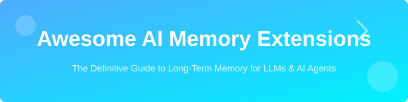
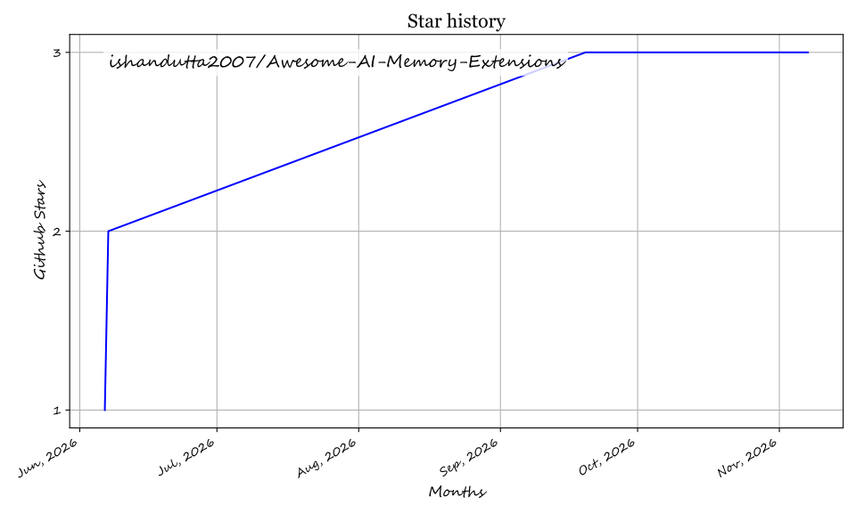

# 🧠 Awesome AI Memory Extensions

  

  

    <strong>The curated collection of dedicated AI memory systems, plugins, and frameworks for persistent long-term memory.</strong>
  

  
  
  
  
  
  
 
 
  

---

## 🚀 Top Dedicated AI Memory Extensions & Plugins Ecosystem

**Curated List of SaaS Products & Open-Source GitHub Projects**  
*Focused on Long-Term Memory, Context Management & Persistent AI Agents*  
**Last updated: June 2026**

This repository tracks notable **SaaS platforms** and **open-source projects** building **Dedicated AI Memory Extensions & Plugins**. These tools give LLMs and agents persistent long-term memory, vector-based recall, conversation history management, knowledge grounding, and self-improving memory systems beyond the limited context window.

### 🎯 Key Features Covered:
- 🧠 **Agentic Memory**: Autonomous self-editing and hierarchical recall.
- 📂 **Context Management**: Infinite context via RAG and vector-based indexing.
- ⚡ **Seamless Integration**: Plugins for Claude, GPT, Ollama, and local LLMs.
- 🔒 **Privacy First**: Open-source stacks for full data control.

---

## 🗺️ Table of Contents
- [✨ SaaS Products](#-saas-products)
- [📂 Open-Source GitHub Projects](#-open-source-github-projects)
- [🤝 How to Contribute](#-how-to-contribute)
- [💖 Support](#-support)
- [⚠️ Disclaimer](#-disclaimer)
- [📈 Star History](#-star-history)

---

## ✨ SaaS Products

### 🛠️ Core Platforms (AI Memory Extensions)

| Product | Description | Pricing | Free Tier / Trial | Market Size / Valuation |
| :--- | :--- | :--- | :--- | :--- |
| **[Claude Pro](https://claude.ai/)** | Native persistent knowledge & cross-session memory. | Pro: $20/mo, Team: $30/user/mo | Basic session memory | $965B Valuation / $47B+ ARR |
| **[Cognee Cloud](https://cognee.ai/)** | Managed self-hosted & cloud AI memory engine turning data into dynamic knowledge graphs. | $1/1M tokens, $5/mo per extra workspace | Free tier: 1M tokens, 1 workspace | High-growth Graph-RAG / Memory |
| **[Letta](https://letta.ai/)** | Infinite context via hierarchical memory & autonomous recall. | Pro: $20/mo, Max: $200/mo | 3 agents (BYOK) | $70M Valuation |
| **[Mem0 Cloud](https://mem0.ai/)** | Managed memory layer for personalized LLM agents. | Starter: $19/mo, Growth: $79/mo | 10,000 requests/mo | $150M Valuation |
| **[MemoryPlugin](https://memoryplugin.com/)** | Dedicated memory layer with smart retrieval for assistants. | Core: $10/mo, Pro: $25/mo | 14-day trial | $24k ARR (Bootstrapped) |
| **[MemSearch](https://memsearch.ai/)** | Large-scale intelligent search & retrieval for agents. | Managed via Zilliz (~$65/mo) | Free Local OS version | Zilliz: $113M+ Funding |
| **[SuperMemory](https://supermemory.ai/)** | Advanced memory augmentation optimized for Claude. | Pro: $19/mo, Scale: $399/mo | 1M tokens, 10K queries | $20M Valuation |
| **[Zep Cloud](https://getzep.com/)** | Enterprise-grade memory with semantic search. | Flex: $25/mo, Flex Plus: $375/mo | 1,000 credits/mo | $2.3M Valuation |

### 🔍 Advanced & Specialized Platforms

**Other notable mentions**: Various enterprise memory layers and specialized industry agents.

---

## 📂 Open-Source GitHub Projects

### 🛠️ Dedicated AI Memory Systems

- **[Agent Memory Frameworks](https://github.com/search?q=agent+memory+llm)** 🏗️  
  Various community repositories for building hierarchical and self-improving memory systems for autonomous agents.

- **[Claude Memory Extensions](https://github.com/search?q=claude+memory+extension)** 🤖  
  Multiple open-source projects enhancing Claude (and other models) with persistent memory, custom tools, and long-context management.

- **[Claude-Mem](https://github.com/thedotmack/claude-mem)** 🧬  
  Persistent cross-session memory stream for Claude Code and coding agents. Automatically captures CLI lifecycle hooks, tool use, and file edits into SQLite and vector stores with progressive recall.

- **[Cognee](https://github.com/topoteretes/cognee)** 🕸️  
  Memory engine for AI agents and LLMs that builds dynamic knowledge graphs with vector and relational retrieval for continuous context and factual grounding.

- **[Graphiti](https://github.com/getzep/graphiti)** ⏱️  
  Temporal context graph framework by Zep designed for dynamic agent memory. Automatically tracks evolving facts, temporal validity, and invalidated relationships.

- **[Hyperconsciousness](https://github.com/louis030195/hyperconsciousness)** 🔒
  MIT-licensed developer-alpha Rust engine, CLI, and MCP server for encrypted, append-only knowledge records with scoped, expiring access grants. Agents can search and retrieve records, with capture available through write-enabled grants; source installation is required.

- **[LangMem](https://github.com/langchain-ai/langmem)** 🦜  
  Official LangChain memory management toolkit with advanced recall, summarization, and entity memory features.

- **[Letta (MemGPT)](https://github.com/letta-ai/letta)** 🌟  
  The most popular open-source implementation for giving agents infinite context via hierarchical memory management, self-editing memory, and autonomous recall mechanisms.

- **[Mem0](https://github.com/mem0ai/mem0)** 🧠  
  Production-ready memory layer for LLM agents with user, session, and entity-based memory management. Highly extensible and widely adopted.

- **[MemoryPlugin](https://github.com/search?q=memoryplugin+llm)** 🧩  
  Community-driven open-source memory extensions for various LLM frameworks.

- **[Recall](https://github.com/recall-ai/recall)** 🔍  
  Lightweight open-source memory plugin for local LLMs and agents with semantic search capabilities.

- **[SoloPup Memory](https://github.com/OakcoderX/solopup-memory)** 🧩 
  MIT public-beta DeepSeek Harness text-memory plugin preserving original-source references, global/project scope, conditions and correction history through lexical retrieval; model APIs may charge.

- **[SuperMemory](https://github.com/supermemoryai/supermemory)** 🧠  
  Open-source personal knowledge management + AI memory system inspired by claude-supermemory with powerful retrieval.

- **[Tree Ring Memory](https://github.com/TerminallyLazy/Tree-Ring-Memory)** 🌲
  Local-first Rust CLI/TUI for AI-agent memory lifecycle records, SQLite/FTS recall, redaction, deletion, consolidation, and audit trails.

- **[Zep](https://github.com/getzep/zep)** ⚡  
  Open-source long-term memory store for LLM applications with vector search, semantic memory, and conversation history management.

### 📚 Additional Strong Open-Source Options

- **[LlamaIndex Memory Modules](https://github.com/run-llama/llama_index)** 🦙 — Advanced memory and chat engine features.
- **[Haystack Memory Components](https://github.com/deepset-ai/haystack)** 🌾 — Production-grade memory for RAG and agents.
- **[Phidata Memory](https://github.com/phidatahq/phidata)** 📈 — Built-in memory, knowledge, and tool support for agents.
- **[AutoGen Memory Extensions](https://github.com/microsoft/autogen)** 🤖 — Multi-agent memory management patterns.
- **[Obsidian + Local LLM Plugins](https://github.com/obsidianmd/obsidian-releases)** 📓 — Popular for building personal AI memory vaults.
- **Many Ollama + Vector DB stacks** (Chroma, Qdrant, LanceDB) for fully local long-term recall.

---

## 🤝 How to Contribute

1. **Fork** the repo.
2. **Add/edit** entries in `README.md` (follow existing format).
3. **Include**: name, link, 1–2 sentence description, and whether it's SaaS or open-source.
4. **Submit PR** with a short explanation.

⭐ **Star the repo if you find it useful!**

---

## 💖 Support

Thank you for exploring and supporting **Awesome AI Memory Extensions**! If you find this curated resource helpful for your projects, research, or workflows, please consider supporting the project:

- ⭐ **Star** this repository to show your appreciation and help others discover it.
- 🍴 **Fork** and contribute new memory tools, plugins, or improvements.
- 📢 **Share** it with your network, colleagues, and AI agent builder communities.
- ☕ **Buy me a coffee / Sponsor**: If you'd like to support ongoing curation and maintenance, consider sponsoring via the [GitHub Sponsor Dashboard](https://github.com/sponsors/ishandutta2007). Every contribution is deeply appreciated!

---

## ⚠️ Disclaimer

- This is a **community-curated** list — not exhaustive and not an endorsement.
- Memory systems can retain sensitive information — always ensure strong privacy and security practices.
- Performance and recall accuracy vary based on implementation and underlying vector store.

---

## 📈 Star History

---

**Made for AI agent developers, researchers, and power users building persistent intelligent systems.**  
Let's give AI true long-term memory with full privacy and control.

## ⭐ Star History

<a href="https://star-history.com/#ishandutta2007/Awesome-AI-Memory-Extensions&Timeline" align="center">
  <picture>
    <source media="(prefers-color-scheme: dark)" srcset="assets/ishandutta2007_Awesome-AI-Memory-Extensions_growth.svg">
    
  </picture>
</a>
